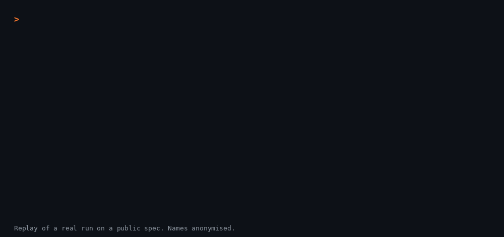

# google-docs-mcp

[](https://github.com/yeyo11/google-docs-mcp/actions/workflows/ci.yml)
[](https://www.npmjs.com/package/@yeyo11/google-docs-mcp)
[](LICENSE)
[](https://nodejs.org)
[](https://modelcontextprotocol.io)
[](https://glama.ai/mcp/servers/yeyo11/google-docs-mcp)

A **read-only** [Model Context Protocol](https://modelcontextprotocol.io) server for Google Docs.
Its job is to explain a document's **comments** to an AI assistant (Claude or any MCP client) in full detail:
who wrote each one, when, on which piece of text, whether it is open or resolved, the complete reply thread,
and who resolved it.



- **Read-only by design.** It only requests the `documents.readonly` and `drive.readonly` scopes. There is no tool
  that creates, edits, resolves or deletes anything, and every tool is advertised with `readOnlyHint: true`.
- **OAuth 2.0 sign-in.** Users authenticate with their own Google account through the desktop-app flow with PKCE.
  Tokens are stored locally and refreshed automatically (see the
  [seven-day exception](#1-create-an-oauth-client-in-google-cloud) for External apps in Testing mode).
- **Zero configuration for the assistant.** Tools accept a document ID *or* a full Google Docs URL.

Built by José Antonio Garrido. I write about the developer tools I build on my blog,
[josegarrido.dev](https://josegarrido.dev/en/?utm_source=github&utm_medium=referral&utm_campaign=google-docs-mcp-readme).

## Tools

| Tool | What it does |
| --- | --- |
| `list_comments` | **The main tool.** Every comment in full detail: author, dates, open/resolved status, quoted text, the whole reply thread (including who resolved or reopened it) and, optionally, the paragraph of the document where the quoted text appears. Filter by status, include deleted comments, paginate, and choose `markdown` or `json` output. |
| `get_comments_summary` | Aggregate view: counts by status, participants and their activity, open comments with no replies, open comments waiting for the original author, oldest open comment and latest activity. |
| `get_comment` | A single comment thread by ID, with context. |
| `get_document` | Document metadata plus plain-text content (all tabs), so the assistant can understand what the comments refer to. |
| `list_documents` | Search Google Docs in Drive (shared drives included) by title or full text. |
| `get_auth_status` | Whether the server is signed in and with which account. |

### Example: `list_comments`

```markdown
# Q4 project plan
- Document ID: `1AbC...`
- Link: https://docs.google.com/document/d/1AbC.../edit
- Owner: Ana <ana@example.com>
- Last modified: 2026-09-22 08:00 UTC by Jose <jose@example.com> (you)

## Comments (all): 2

### [1] 🟢 OPEN — Ana · 2026-09-22 08:00 UTC

**Quoted text (what the comment refers to):**
> delivery date

**Surrounding paragraph (#7):**
> The delivery date will be shared with the client once the scope is final.

**Comment:**
The delivery date is missing.

_No replies yet._

Comment ID: `AAAAxyz`

### [2] ✅ RESOLVED — Ana · 2026-09-20 10:32 UTC
...
**Thread (2 replies):**
  - Jose (you) · 2026-09-21 09:00 UTC: Yes, moving it.
  - Jose (you) · 2026-09-21 12:00 UTC — marked as RESOLVED

Resolved by Jose (you) on 2026-09-21 12:00 UTC.
```

Comment and reply authors appear by display name: the Drive API
[doesn't populate their email address](https://developers.google.com/workspace/drive/api/reference/rest/v3/comments).
A document's owner and last editor show an email when Google
[makes it visible](https://developers.google.com/workspace/drive/api/reference/rest/v3/User) to you.

## Quick start

### Prerequisites

- Node.js >= 20
- A Google Cloud project with the **Google Drive API** and **Google Docs API** enabled

### 1. Create an OAuth client in Google Cloud

1. Open the [Google Cloud Console](https://console.cloud.google.com/) and create or select a project.
2. **APIs & Services → Library**: enable *Google Drive API* and *Google Docs API*.
3. **APIs & Services → OAuth consent screen**: configure it. Use *Internal* for a Workspace organization; for
   *External* apps in testing mode, add your account as a test user.
4. **APIs & Services → Credentials → Create credentials → OAuth client ID**, application type **Desktop app**.
5. Download the JSON and save it as `~/.config/google-docs-mcp/credentials.json`.

> **External apps in Testing mode have to sign in again every seven days.** With an *External* consent screen whose
> publishing status is *Testing*, Google
> [issues a refresh token that expires in 7 days](https://developers.google.com/identity/protocols/oauth2#expiration),
> so automatic renewal stops working and tools report that the sign-in expired until you repeat step 2. The running
> server picks up the new sign-in without a restart. An *Internal* consent screen (Workspace organizations only) doesn't
> have this limit. Neither does publishing the app (*In production*), but `drive.readonly` is a restricted scope, so
> Google then
> [shows an unverified-app warning and caps the project at 100 users](https://support.google.com/cloud/answer/15549945)
> unless the app is verified.

You can use environment variables instead of the file:

```bash
export GOOGLE_CLIENT_ID="...apps.googleusercontent.com"
export GOOGLE_CLIENT_SECRET="..."
```

### 2. Sign in with Google

```bash
npx -y -p @yeyo11/google-docs-mcp google-docs-mcp-auth
```

Your browser opens (or the URL is printed so you can paste it). Google asks for **read-only** access to Drive and
Docs. Tokens are saved to `~/.config/google-docs-mcp/token.json` with `0600` permissions. Run the same command
again to switch accounts.

### 3. Register the server with your MCP client

No clone or build step is needed; `npx` fetches the package on first use.

**Claude Desktop** (`claude_desktop_config.json`):

```json
{
  "mcpServers": {
    "google-docs": {
      "command": "npx",
      "args": ["-y", "@yeyo11/google-docs-mcp"]
    }
  }
}
```

**Claude Code**:

```bash
claude mcp add google-docs -- npx -y @yeyo11/google-docs-mcp
```

Any other MCP client that supports stdio servers works the same way. If you use environment variables for the OAuth
client, add them to the `env` block of your client configuration.

<details>
<summary>Running from source instead</summary>

```bash
git clone https://github.com/yeyo11/google-docs-mcp.git
cd google-docs-mcp
npm install
npm run build
npm run auth
```

Then point your MCP client at `node /absolute/path/to/google-docs-mcp/dist/index.js`.

</details>

### 4. Ask away

> "Summarize the open comments in https://docs.google.com/document/d/…/edit and tell me which ones are waiting on me."

## Configuration

| Variable | Description | Default |
| --- | --- | --- |
| `GOOGLE_OAUTH_CREDENTIALS` | Path to the OAuth client JSON. | `~/.config/google-docs-mcp/credentials.json` |
| `GOOGLE_CLIENT_ID` / `GOOGLE_CLIENT_SECRET` | Alternative to the JSON file. | — |
| `GOOGLE_DOCS_MCP_TOKEN_PATH` | Where the user's tokens are stored. | `~/.config/google-docs-mcp/token.json` |
| `GOOGLE_DOCS_MCP_CONFIG_DIR` | Base directory for the two files above. | `~/.config/google-docs-mcp` |

## How it works

```
MCP client ──stdio──▶ google-docs-mcp ──OAuth2 (read-only)──▶ Google Drive API (files, comments)
                                                            └▶ Google Docs API (document text)
```

- Comments come from the Drive API (`comments.list` / `comments.get`) with every field requested explicitly, so
  nothing is silently dropped: quoted text, replies, `resolve`/`reopen` actions, deleted flags.
- The "surrounding paragraph" is found by locating the quoted text inside the document body fetched from the Docs
  API (all tabs are traversed, including tables).
- Google API errors (401/403/404/429) are returned as MCP `isError` results with an actionable message instead of
  breaking the session. Logs go to `stderr`; `stdout` is reserved for the protocol.

## Development

```bash
npm run dev        # run the server from src/ with tsx
npm run typecheck  # type-check without emitting
npm test           # smoke test: tool listing, error handling without credentials, comment formatting
```

See [CONTRIBUTING.md](CONTRIBUTING.md) for the workflow and commit conventions.

## Security

- Only read-only scopes are requested; Google never grants this client write access.
- If the stored token lacks the expected scopes, the server refuses to use it and asks you to sign in again.
- `credentials.json` and `token.json` are git-ignored. Never commit them.
- To revoke access, remove the app at <https://myaccount.google.com/permissions> and delete `token.json`.

To report a vulnerability, see [SECURITY.md](SECURITY.md).

An independent review of the server's access and security is on mcprush:

[](https://mcprush.com/to/yeyo11-google-docs-mcp?ref=badge)

## Limits

- **Read-only.** It can't create, reply to or resolve comments, or edit documents.
- **Google Docs only.** Sheets, Slides and other file types are refused, by URL and by bare ID.
- **Suggestions, assignments and mentions aren't read as such.** A comment is its text, status and thread: an assigned
  comment looks like any other and a mention is just part of the text. Depending on your access, text pending as a
  suggestion [can appear](https://developers.google.com/workspace/docs/api/how-tos/suggestions) in `get_document` as
  ordinary text.
- **Comment authors are told apart by display name**, since Drive doesn't return their email. In
  `get_comments_summary`, two people with the same name count as one.
- **`get_document` returns plain body text** from all tabs, tables included: no formatting, images, smart chips, headers,
  footers or footnotes. 20,000 characters by default, 500,000 at most (`max_chars`).
- **The surrounding paragraph is found by searching for the quoted text.** It takes the first match, so a repeated
  phrase can point to the wrong paragraph, and it may be missed if the text was edited after the comment. Quotes under
  8 characters get no paragraph, and paragraphs over 600 characters are trimmed.
- **`list_comments` pages by 100.** Use `page_token` for the rest. The `status` filter applies to each page, so a page
  can come back short or empty while more remain. `get_comments_summary` reads every page.
- **One Google account per installation.** Run the sign-in command again to switch.
- **Local stdio only.** There is no remote or HTTP transport.
- **Tokens are stored unencrypted** in `token.json`, with `0600` permissions.
- **`drive.readonly` covers all of Drive the account can see**, not only Docs. The tools read Docs only, but that is
  what you grant on Google's sign-in screen and what the stored token allows.
- **What a tool returns reaches the assistant.** Document text, comments, names and email addresses go to whichever
  assistant and model provider you use. Text written by other people arrives as is, so treat it as untrusted.

## Roadmap

- [ ] Optional write tools (reply, resolve) behind an explicit opt-in scope
- [ ] Multiple accounts / profiles
- [ ] Streamable HTTP transport for remote deployments

## License

[MIT](LICENSE)
